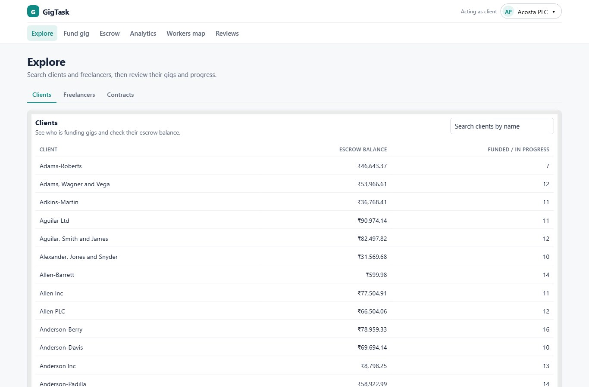
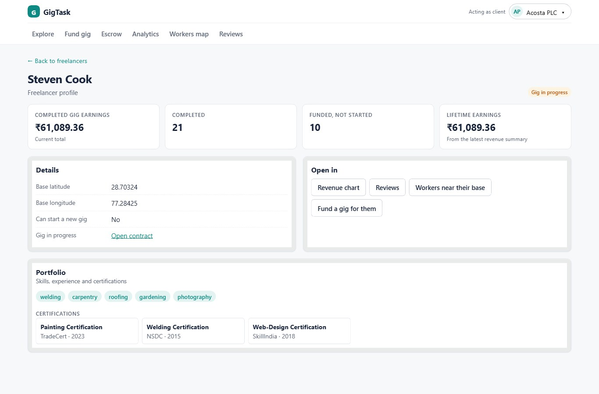
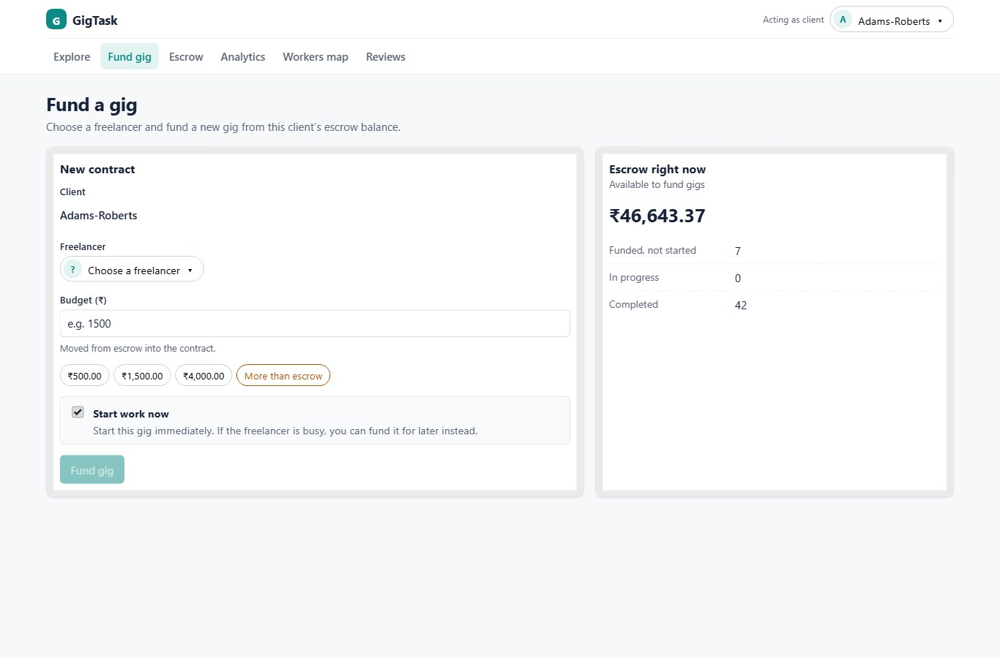
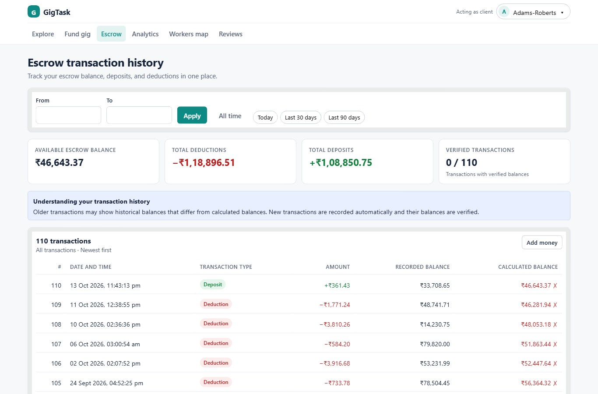
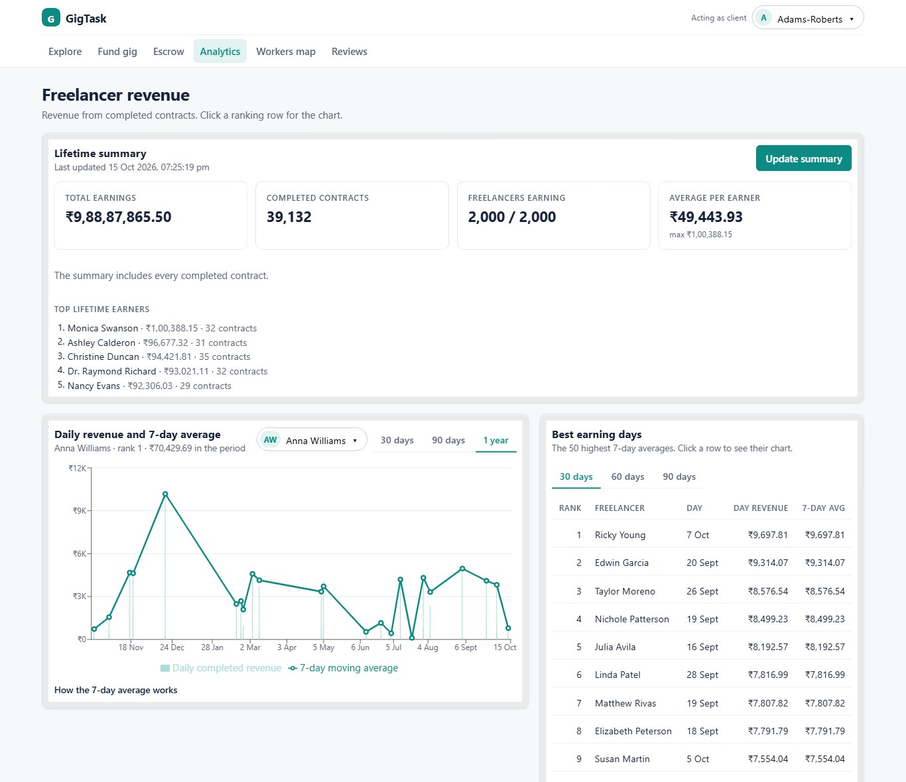
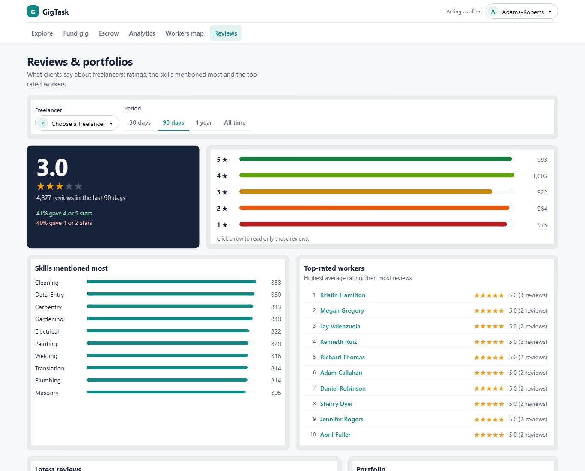
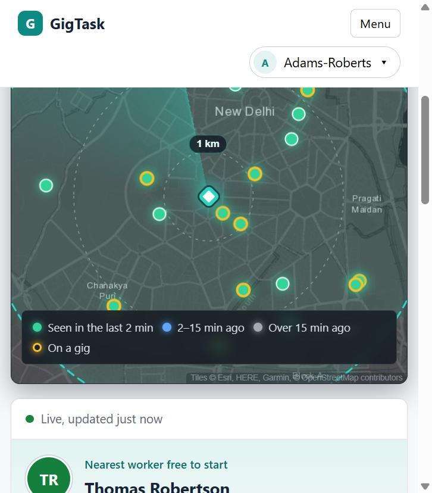
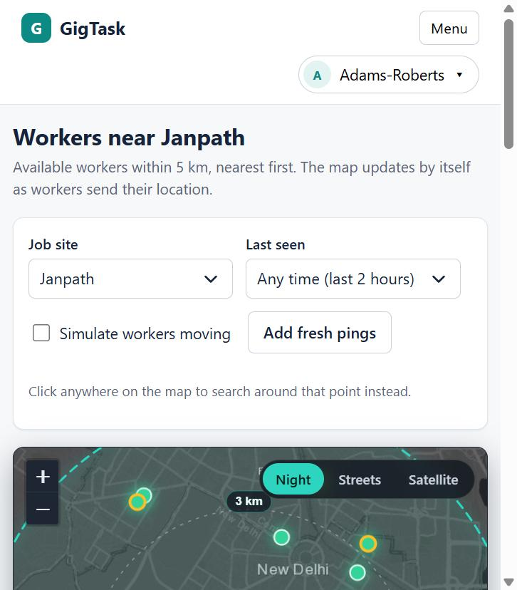

# GigTask UI

GigTask is a freelance micro-jobs marketplace where clients find freelancers, fund gigs from escrow, and review work and earnings. This repository carries forward the [GigTask database project](https://github.com/MohitSharma25/GitTask) and its commit history, then adds an API and a web frontend for Assignment 2.

The app uses PostgreSQL for clients, freelancers, contracts, escrow and revenue, and MongoDB for portfolios, reviews and worker locations. The client picker in the header is a demo actor switcher; there is no real login.

## Repository structure

| Folder     | Contents                                                                                                                                                            |
| ---------- | ------------------------------------------------------------------------------------------------------------------------------------------------------------------- |
| `db/`      | Inherited Part A database work and one additive UI support script. Its `sql/`, `mongo/` and `data_generation/` subfolders contain the database scripts and seeders. |
| `api/`     | Express API connecting the frontend to both databases.                                                                                                              |
| `web/`     | React and Vite frontend, with screen and component tests.                                                                                                           |
| `docs/`    | Requirements, endpoint reference, design work and handover note.                                                                                                    |
| `scripts/` | Database setup scripts and a Windows app startup script.                                                                                                            |

The original database setup instructions are in [`db/README.md`](db/README.md). Run its relative commands from the `db/` directory. `db/sql/07_ui_support.sql` is an additive table for recording materialized-view refresh times in the UI; files `01`–`06` are inherited from the original project.

## Assumptions

1. **Currency is ₹**, since freelancer locations are in Delhi NCR.
2. **There is no real login.** The demo user is a **client**, chosen with the _Acting as client_ picker in the header, because clients fund gigs and own the escrow.
3. **"Active gig" means `IN_PROGRESS`**, as in the inherited index `idx_active_gig`. A freelancer can have several funded contracts waiting, but only one in progress.
4. **Contract statuses only move forward**: FUNDED → IN_PROGRESS → COMPLETED. The API enforces this.
5. **Revenue is the budget of COMPLETED contracts, dated by `created_at`**, as in the inherited analytics query (there is no completion-date column).
6. **The 7-day moving average keeps the inherited definition**: it averages only the days that had revenue in the 7-day window.
7. **Job sites** are preset points in the seeded area, or any point clicked on the map, because the database has no job-site table. The search radius is 5 km.
8. **The map shows one row per worker** (their latest available location within 5 km). A worker is **busy** if they have an IN_PROGRESS contract.
9. **"Add fresh pings" and "Simulate workers moving" insert location pings** in the same format as the seeder. They stand in for workers' phones sending their location, because seeded pings expire after two hours.
10. **Amounts** have at most 2 decimal places and are at most ₹99,999,999.99, matching the `DECIMAL(10,2)` columns.
11. **Dates use Indian time** (Asia/Kolkata), set on the database container.
12. **Older escrow history may not add up.** The inherited seeder wrote random balances into the audit rows, so the Escrow screen calculates balances back from each client's current balance. Every transaction made in this app is recorded by the trigger and adds up exactly.
13. **The inherited Part A scripts are unchanged** under `db/`. The only addition is `db/sql/07_ui_support.sql`, which records when the lifetime earnings summary was last updated.

## Technology choices

| Layer         | Choice                                                  | Why                                                                                                                                                                                                             |
| ------------- | ------------------------------------------------------- | --------------------------------------------------------------------------------------------------------------------------------------------------------------------------------------------------------------- |
| Databases     | **PostgreSQL 16**, **MongoDB 8**                        | The inherited databases: PostgreSQL keeps escrow funding and contract changes transactional and supplies revenue analytics; MongoDB stores flexible portfolios and reviews and supports nearby-worker searches. |
| API           | **Node.js + Express**, `pg`, `mongodb`                  | One API between the browser and both databases; official drivers; the API stays a thin layer and lets the database do the work (`fund_gig`, the audit trigger, the window query, `$geoNear`, `$facet`).         |
| Front end     | **React 18 + Vite**                                     | Reusable components across seven screens; fast reload; Vite forwards `/api` to the API, so no CORS setup.                                                                                                       |
| Data fetching | **TanStack Query**                                      | Loading, error and empty states, caching, no flicker while paging, and polling for the live map.                                                                                                                |
| Routing       | **React Router**                                        | Screen state lives in the URL, so links and back/forward work.                                                                                                                                                  |
| Charts        | **Recharts**                                            | Simple bar and line charts for analytics.                                                                                                                                                                       |
| Map           | **Leaflet** with free tile services                     | No API key needed.                                                                                                                                                                                              |
| Tests         | **node:test** (API), **Vitest + Testing Library** (web) | No extra test tools for the API; screens are tested the way a user uses them.                                                                                                                                   |
| Seeding       | **Python**                                              | Runs the inherited seeders.                                                                                                                                                                                     |
| Setup         | **Docker Compose** (optional)                           | Runs both databases with known ports for a repeatable setup.                                                                                                                                                    |

## Requirements and setup

You need Node.js 20.12 or newer, npm and Python 3. Run PostgreSQL 16 and MongoDB through Docker Compose, or install both databases and `mongosh` locally. The seeders need the Python packages in `db/data_generation/requirements.txt`.

### Docker Compose databases

From the repository root, the setup scripts start PostgreSQL and MongoDB, create their collections and tables, and seed both databases. Docker publishes PostgreSQL on port `5433` and MongoDB on `27018`.

On macOS, Linux or Git Bash:

```bash
python3 -m venv venv
source venv/bin/activate
./scripts/setup_db.sh
cp api/.env.example api/.env
```

On Windows PowerShell:

```powershell
powershell -ExecutionPolicy Bypass -File scripts\setup.ps1
Copy-Item api\.env.example api\.env
```

The setup scripts stop if PostgreSQL already contains tables. Their reset options (`--reset` on macOS/Linux, `-Reset` on Windows) delete existing demo data and seed it again.

### Databases installed without Docker

Start PostgreSQL and MongoDB locally. Set `PGHOST`, `PGPORT`, `PGDATABASE`, `PGUSER`, `PGPASSWORD`, `MONGO_URI` and `MONGO_DB` for the Python seeders. Use an existing PostgreSQL role and its password rather than assuming a `postgres` role exists; local installations commonly use ports `5432` and `27017`.

From the repository root:

1. Create the `gigtask` PostgreSQL database. Run `db/sql/01_schema_ddl.sql` through `05_materialized_views.sql` in order, followed by `db/sql/07_ui_support.sql`.
2. Install `db/data_generation/requirements.txt` and run `db/data_generation/postgres_seeder.py`.
3. Run `SELECT refresh_freelancer_lifetime_stats();` in `gigtask`, then record the initial refresh in `mv_refresh_log` as shown in [`scripts/setup_db.sh`](scripts/setup_db.sh).
4. Run `db/mongo/01_collections_and_indexes.js` in `mongosh`, then run `db/data_generation/mongo_seeder.py`. The MongoDB seeder needs the PostgreSQL freelancers created in step 2.
5. Copy `api/.env.example` to `api/.env` and set the same credentials and local ports there. The API reads this file; the Python seeders read shell environment variables.

See [`db/README.md`](db/README.md#setup) for the inherited database commands. Its examples run from `db/` and use local database ports; the additional `07_ui_support.sql` and refresh-log step above are needed for this app.

### Run the app

In separate terminals from the repository root:

```bash
cd api
npm install
npm start
```

```bash
cd web
npm install
npm run dev
```

Open [http://localhost:5173](http://localhost:5173). The API runs on `http://localhost:4000`; Vite forwards `/api` requests to it. On Windows with Docker, [`scripts/start.ps1`](scripts/start.ps1) can start both app processes after setup. `GET /api/health` reports whether both databases are reachable.

### Troubleshooting

| Problem                                         | Fix                                                                                                              |
| ----------------------------------------------- | ---------------------------------------------------------------------------------------------------------------- |
| Every screen shows "Could not load this"        | The API is not running: `cd api && npm start`                                                                    |
| Only Workers map and Reviews show an error      | MongoDB is down: `docker compose up -d`                                                                          |
| Setup says ports 5433 / 27018 are in use        | Stop the containers it lists (`docker stop <name>`), then run setup again                                        |
| Setup says the database already has data        | Run setup with `-Reset` / `--reset`                                                                              |
| Workers map: "No available workers within 5 km" | Seeded locations expire 2 hours after seeding. Press **Add fresh pings** or turn on **Simulate workers moving**. |

## Screens and demo flow

| Screen          | What to try                                                                                                  |
| --------------- | ------------------------------------------------------------------------------------------------------------ |
| **Explore**     | Search and page through clients, freelancers and contracts; open profiles and change a contract's status.    |
| **Fund gig**    | Choose a client and freelancer, enter a budget, and see the escrow balance before and after funding.         |
| **Escrow**      | Review deposits, deductions and running balances for the selected client.                                    |
| **Analytics**   | View freelancer revenue, the seven-day average, rankings and lifetime earnings; update the lifetime summary. |
| **Workers map** | Find available workers within 5 km of a job site and see location updates.                                   |
| **Reviews**     | Explore ratings and skill tags; open a freelancer's portfolio from their profile.                            |

The app includes loading, empty and error states, and layouts for laptop and phone screens. The detailed [requirements and persona map](docs/requirements_and_screens.md) and [screen designs](docs/design/wireframes.md) describe each workflow.

## Screenshots

Screenshots of the running app on the seeded data, in [docs/screenshots/](docs/screenshots/). The screen designs are in [docs/design/wireframes.md](docs/design/wireframes.md).

| Explore                                     | Freelancer profile                                             |
| ------------------------------------------- | -------------------------------------------------------------- |
|  |  |

| Fund gig                                      | Escrow                                    |
| --------------------------------------------- | ----------------------------------------- |
|  |  |

| Analytics                                       | Reviews                                     |
| ----------------------------------------------- | ------------------------------------------- |
|  |  |

| Workers map                                         | Narrow screen layout                                           |
| --------------------------------------------------- | -------------------------------------------------------------- |
|  |  |

## API, tests and known data behavior

The [API endpoint reference](docs/api_endpoints.md) lists request inputs and responses. Run the checks from each application folder:

```bash
cd api && npm test
cd ../web && npm test && npm run build
```

The API also has a database-backed funding integration test (`cd api && npm run test:integration`), which requires a seeded PostgreSQL database and changes demo data. Worker location pings expire after two hours; the Workers map can add fresh pings for a demo. See the [database handover note](docs/handover_note.md) for inherited behavior, verified fixes and remaining verification work.

## Team contributions

Work was divided by screen. Each member owned the design and the code for their screens; shared parts are listed under the member who built them. In [docs/design/wireframes.md](docs/design/wireframes.md), each member is responsible for the sketches and screen designs of their own screens, and the users section was agreed by the whole team.

| Member                  | Roll no.   | Design                                               | Code                                                                              | Docs / tests                         |
| ----------------------- | ---------- | ---------------------------------------------------- | --------------------------------------------------------------------------------- | ------------------------------------ |
| Manjeet Singh Seegriwal | 2026201022 | Explore, Freelancer page, Fund gig                   | Explore, detail pages, Fund gig; database setup in this repository                | Explore and Fund gig tests           |
| Adwaith Panicker        | 2026201067 | Analytics; design system (colours, type, components) | Analytics; API and backend                                                        | API tests                            |
| Dasari Abhaya Manasa    | 2026202014 | Workers map, Reviews; phone layout                   | Workers map, Reviews, MongoDB routes and pipelines; plain-language error messages | Workers map tests, MongoDB guide     |
| Aniket Anand            | 2026204019 | Escrow; loading / empty / error states               | Escrow; shared web base (layout, components, API client)                          | Project documentation, handover note |

## Repository and submission

- GitHub repo link: [https://github.com/MJT444/newGigTaskUI](https://github.com/MJT444/newGigTaskUI)
- Previously recorded final commit hash: `dd4883f`.
- Demo video: [watch on Google Drive](https://drive.google.com/file/d/1-9lna9s5lECwPm5uzjLuKOdSvk2leRoV/view?usp=drivesdk)
