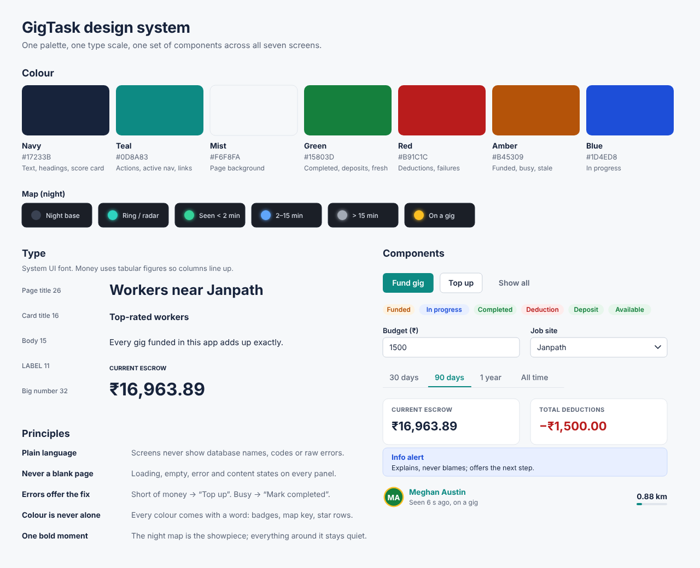

# Design system

One palette, one type scale and one set of components across all seven screens. Implemented in `web/src/styles/global.css` (tokens and components) and `web/src/components/ui.jsx`. Chart colours are repeated in `web/src/lib/theme.js` because chart libraries write colours straight into SVG.

Vector version: [screens/00-design-system.svg](screens/00-design-system.svg). Every screen design is in [wireframes.md](wireframes.md).

## Principles

1. **Consistency over decoration.** Seven screens, one card, one table, one button set.
2. **Plain language.** Screens never show database names, internal IDs, error codes or raw error text. Clients see names, "Deduction / Deposit", "In progress", and sentences that say what happened.
3. **Never a blank page.** Every data panel goes through `QueryState`: loading, then error (with *Try again* when retrying can help), then empty (with a reason), then content.
4. **Errors explain, then offer the fix.** Not enough escrow shows the shortfall and a *Top up* button; a busy freelancer shows the gig that blocks them and *Mark completed*; a bad link offers a way back.
5. **Colour is never alone.** Every colour comes with a word or number: status badges, the map key, the star rows.
6. **One bold moment.** The night-style Workers map is the showpiece; the rest of the app stays calm and light so it does not compete.

## Colour

| Token | Value | Use |
|---|---|---|
| `--text` | `#17233b` navy | text, headings, the reviews score card |
| `--accent` | `#0d8a83` teal | primary buttons, active menu item, links, average line, job site |
| `--bg` / `--surface` | `#f6f8fa` / `#ffffff` | page / cards |
| `--muted` | `#5b6577` | secondary text, labels |
| `--border` | `#e1e6ec` | card and table lines |
| `--success` | `#15803d` | completed, deposits, available, seen in the last 2 min |
| `--danger` | `#b91c1c` | deductions, failures |
| `--warning` | `#b45309` | funded (not started), busy, entries that do not add up |
| `--info` | `#1d4ed8` | in progress, seen 2–15 min ago |

**Workers map (Night look)**

| Colour | Use |
|---|---|
| `#1b1f27` | dark base map |
| `#2dd4bf` | 5 km circle, ring labels, radar sweep, job-site pin outline |
| `#34d399` / `#60a5fa` / `#a3aab5` | worker seen < 2 min / 2–15 min / > 15 min ago |
| `#fbbf24` | ring around a worker who is on a gig |

The map can also be switched to *Streets* (full colour) or *Satellite*; the choice is remembered.

## Type

System font stack (`system-ui`, Segoe UI, Roboto). Page title 26 px bold, card title 16 px semibold, body 15 px, labels 11 px uppercase, headline numbers 22–32 px. Money uses `tabular-nums` so columns line up, and Indian digit grouping (₹1,06,181.98).

## Components

| Component | Purpose |
|---|---|
| `Button` (primary / secondary / ghost, `sm`) | actions; shows a spinner and is disabled while a request runs |
| `Card`, `StatCard` | every panel / headline numbers |
| `DataTable` + `Pagination` | lists; keyboard-accessible rows; label/value cards under 600 px |
| `Badge`, `StatusBadge` | Funded / In progress / Completed, Deduction / Deposit, Available / busy, skill tags |
| `Money` | ₹ with Indian grouping; signed amounts red − / green + |
| `Field`, `.input`, `.chip`, `.checkbox-card` | forms |
| `Tabs` | Explore lists, review periods, ranking periods |
| `Alert` | inline info / warning / danger / success messages |
| `Loading`, `EmptyState`, `ErrorState`, `QueryState` | the four data states |
| `ClientSearch`, `FreelancerSearch` | search-as-you-type pickers |
| `ContractStatusControl`, `BlockingContract` | contract steps and the next action; the fix for a busy freelancer |
| `WorkerMap` | night / streets / satellite map with rings, radar, freshness-coloured dots |
| Nearest-worker spotlight, distance-band list | Workers map side panel |
| Score card, rating rows, skill bars, `Stars` | Reviews summary |
| `PortfolioCard` | a freelancer's portfolio as a readable profile |

## Responsive

| Width | Change |
|---|---|
| ≤ 1100 px | Analytics, Reviews and Workers map side panels move under the main panel |
| ≤ 900 px | menu folds behind a *Menu* button; all two-column grids become one column |
| ≤ 600 px | tables become label/value cards; map is 420 px tall and its key wraps |

No screen scrolls sideways at 375 px. `prefers-reduced-motion` turns off the radar sweep, pulses and flashes.
