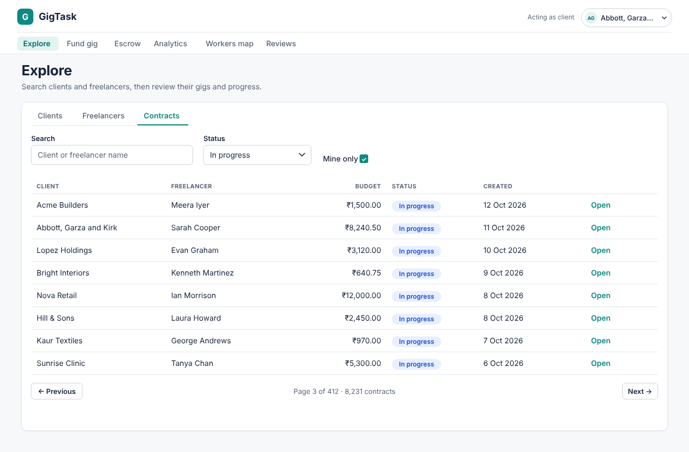
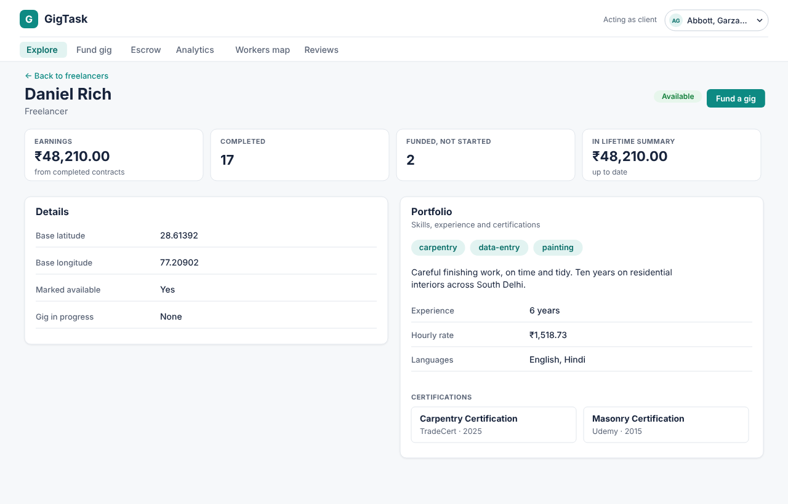
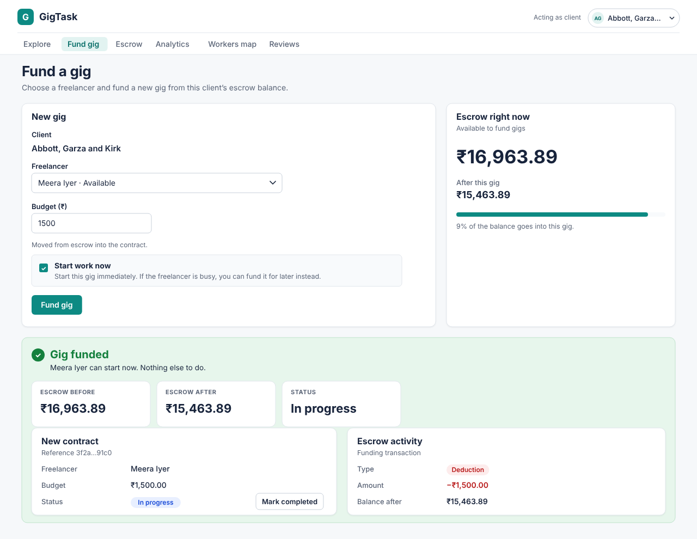
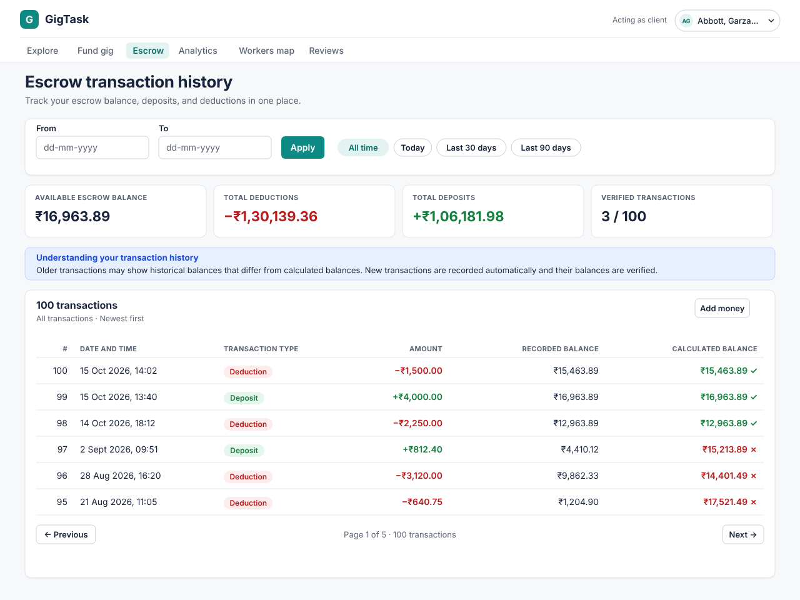
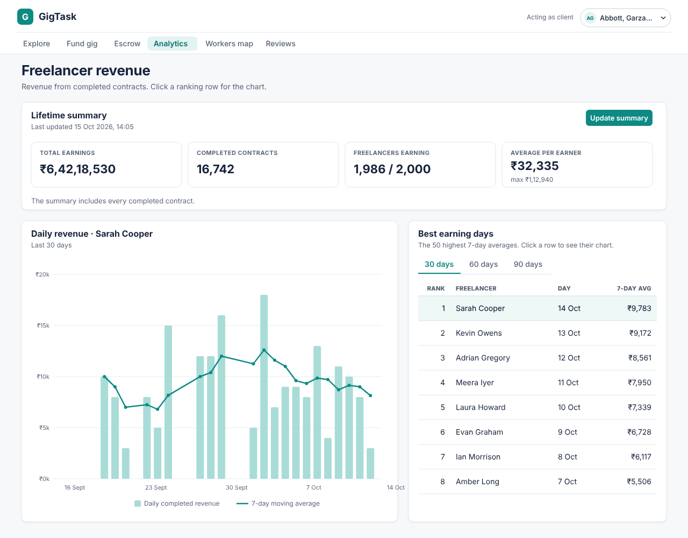
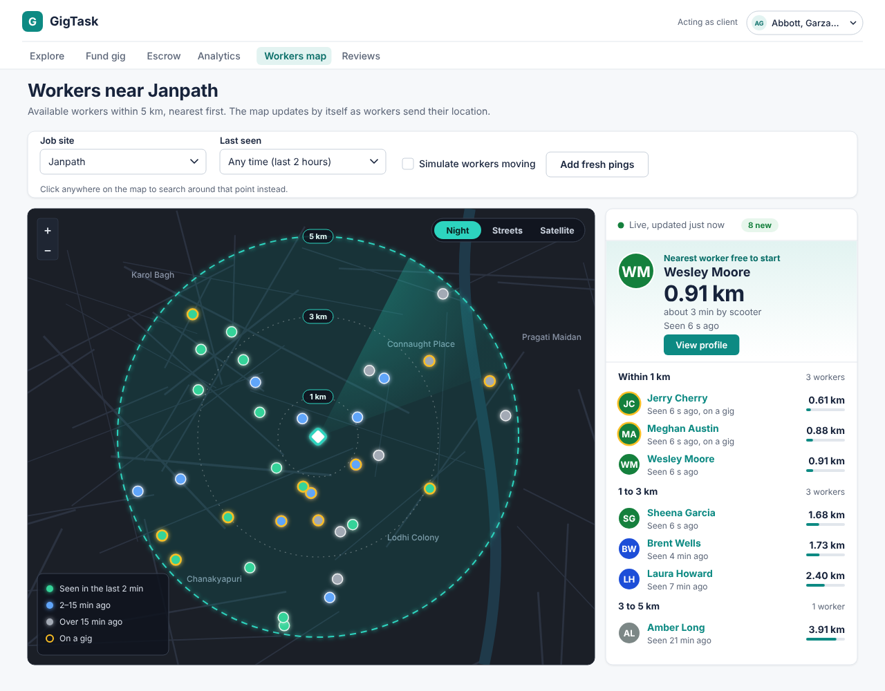
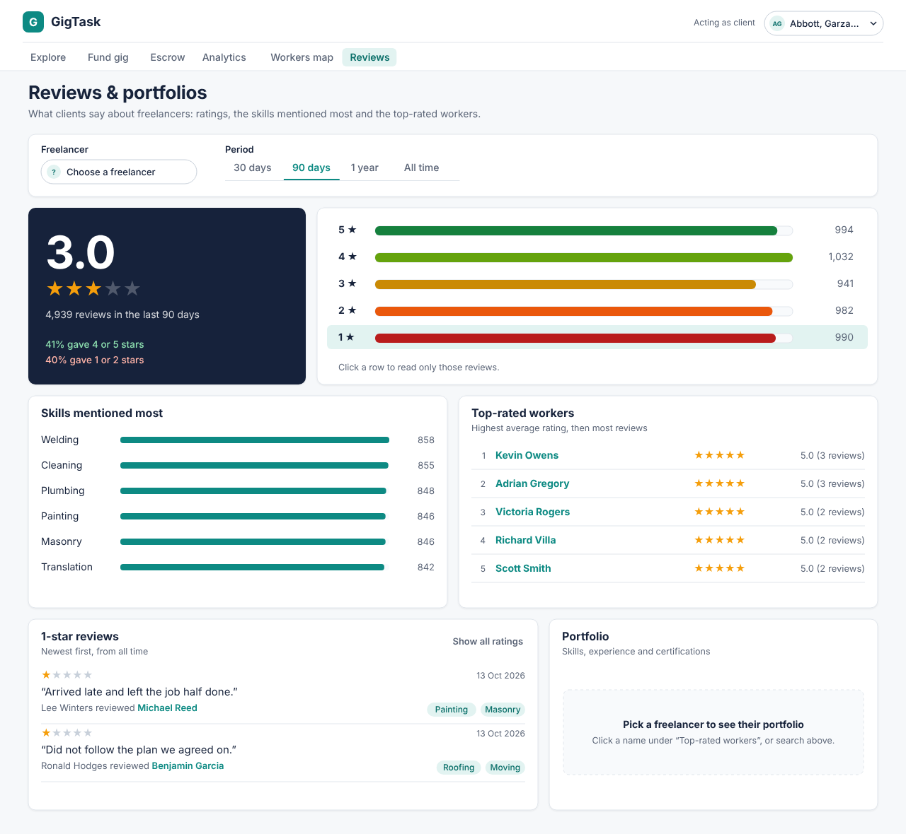
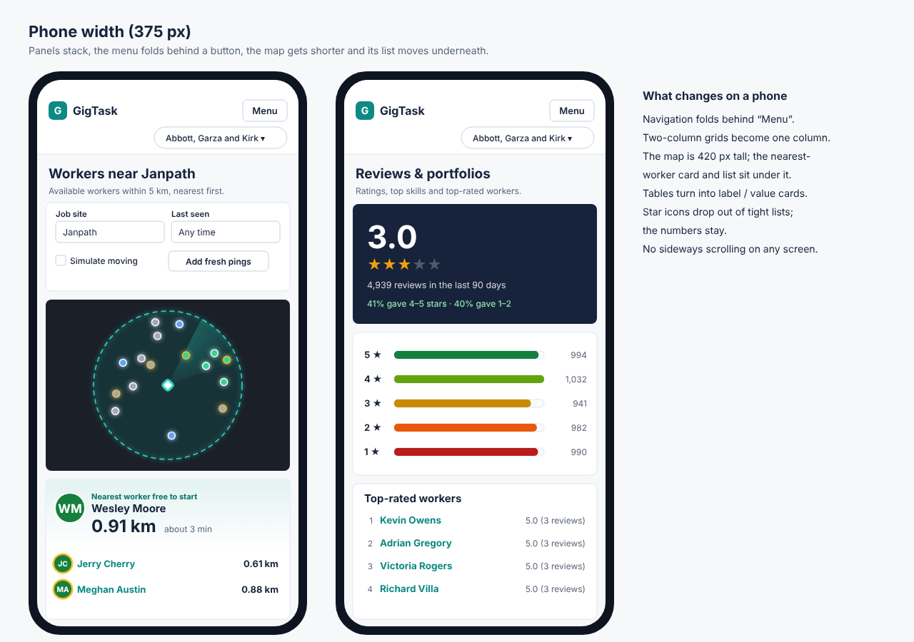
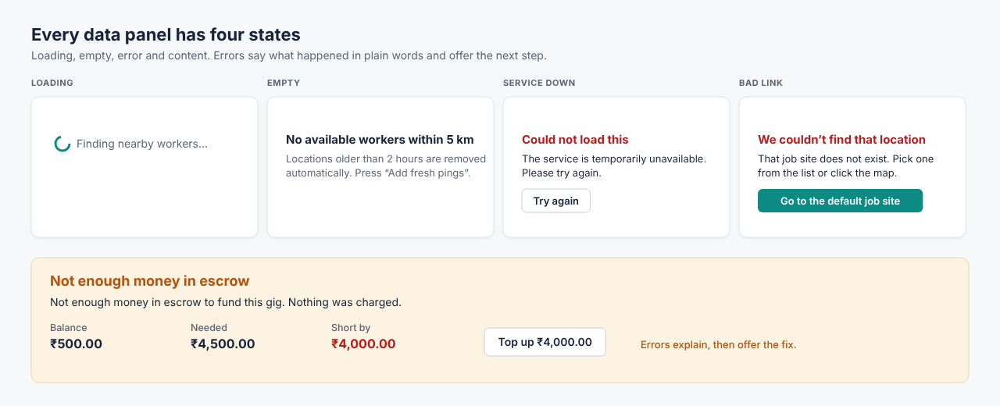

# GigTask design

This folder holds the design work for GigTask in the order we did it:

1. **Who uses it**: the three kinds of users and what each one wants.
2. **First sketches**: rough wireframes drawn *before* building, to agree on screens and layout.
3. **Screen designs**: the final look of every screen, phone views and error states, drawn to match the built app.
4. **What changed while building**, and why.

The colours, type and components are described in [design_system.md](design_system.md).

## 1. Who uses GigTask

| User | Who they are | What they want from the app | Screens they use most |
|---|---|---|---|
| **Client** | A small business or household that needs short jobs done (painting, plumbing, moving, data entry). Holds money in escrow. | Find a reliable freelancer close by, check their reviews, fund a gig safely and see where their money went. | Explore, Fund gig, Escrow, Workers map, Reviews |
| **Freelancer** | A worker who takes gigs and builds a reputation. | See their profile, contracts, earnings and what clients say about them. | Explore, Analytics, Reviews |
| **Demo operator** | The person showing the app (a team member or evaluator). There is no real login. | Switch between clients, move contracts forward and show what happens in edge cases. | Every screen, using the client picker at the top |

**Design decisions that follow from these users**

- Clients are not technical, so **the screens use plain language only**: names instead of IDs, "Deduction / Deposit" instead of database terms, and errors that say what happened and what to do next.
- Money and distance are what clients decide on, so they are shown **large and first**: escrow balance, budget, distance to the nearest worker.
- Everything a client might want to check is **one click away**: every name links to that person's page; every rating row filters the reviews.

## 2. First sketches (before we built anything)

These were drawn at the start to agree on what each screen should contain. They are kept as the record of the design-before-build step; the final designs in section 3 grew out of them.

### Shared shell

```text
+--------------------------------------------------------------------+
| GigTask   Browse  Fund Gig  Escrow  Analytics  Nearby  Reviews     |
|                                                  Demo actor [v]    |
+--------------------------------------------------------------------+
| Screen content                                                     |
+--------------------------------------------------------------------+
```

### 1. Browse

```text
+--------------------------------------------------------------------+
| Clients | Freelancers | Contracts                                  |
| Search [____________________]       Status / skill filter [v]      |
|--------------------------------------------------------------------|
| Name / ID              Summary                         View >       |
| Name / ID              Summary                         View >       |
|--------------------------------------------------------------------|
| < Previous                      Page 1 of N              Next >     |
|--------------------------------------------------------------------|
| Detail drawer: record facts, portfolio preview, contract status    |
| [Move to IN_PROGRESS] [Mark COMPLETED] when applicable             |
+--------------------------------------------------------------------+
```

### 2. Fund a gig

```text
+--------------------------------+-----------------------------------+
| Client [v]                     | Escrow before: amount             |
| Freelancer [v]                 | Escrow after: amount              |
| Budget [________]              | Contract: ID, status FUNDED       |
| [Fund gig]                     | New audit entry: amount, time     |
+--------------------------------+-----------------------------------+
| Clear success or specific funding / constraint error               |
+--------------------------------------------------------------------+
```

### 3. Escrow audit

```text
+--------------------------------------------------------------------+
| Client [v]        From [date]        To [date]       [Apply]        |
| Current escrow: amount                                             |
|--------------------------------------------------------------------|
| Date          Action          Change          Running balance       |
| ...           DEBIT           ...             ...                   |
+--------------------------------------------------------------------+
```

### 4. Analytics

```text
+--------------------------------------------------------------------+
| Freelancer [v]       Period [v]        [Refresh lifetime stats]    |
| Last refreshed: date and time                                      |
|--------------------------------------------------------------------|
| Completed contracts        Total earnings       Rank               |
|--------------------------------------------------------------------|
| Seven-day moving-average earnings chart                            |
|--------------------------------------------------------------------|
| Rank           Freelancer              Moving average / earnings   |
+--------------------------------------------------------------------+
```

### 5. Nearby workers

```text
+--------------------------------------------------------------------+
| Job-site origin: [longitude] [latitude]     Radius: 5 km [Search] |
|--------------------------------------------------------------------|
|                                      | Worker   Distance   Ping age  |
|                 MAP                  | ...      0.8 km     now       |
|           job site + workers         | ...      1.6 km     1 min     |
|                                      | Auto-updating                 |
+--------------------------------------------------------------------+
```

### 6. Reviews and portfolio

```text
+--------------------------------------------------------------------+
| Freelancer [v]       Overall average: 4.2      Reviews: 125       |
|--------------------------------------------------------------------|
| Rating distribution chart     | Top skill-tag chart                |
|--------------------------------------------------------------------|
| Portfolio: skills, certifications, experience, bio, hourly rate   |
+--------------------------------------------------------------------+
```

Every screen also needs explicit loading, empty, and error presentations. The numbers above are layout examples, not claims about seeded data.

## 3. Screen designs

All screens share one frame: the GigTask logo, the six-item menu (the current screen highlighted in teal) and the client picker on the right. Each design below uses the same cards, buttons, badges and tables (see [design_system.md](design_system.md)).

### Explore

Search and page through clients, freelancers and contracts. Status is a coloured badge with a word, money is right-aligned so it lines up.



<sub>Vector version: [screens/01-explore.svg](screens/01-explore.svg)</sub>

### Freelancer page

Headline numbers in four cards, then their details and the portfolio as a readable profile (skills, bio, rate, certifications).



<sub>Vector version: [screens/02-freelancer-detail.svg](screens/02-freelancer-detail.svg)</sub>

### Fund a gig

The form on the left, the escrow balance (before and after) on the right, so the client sees the effect before pressing the button. Success shows the new contract and the money that moved.



<sub>Vector version: [screens/03-fund-gig.svg](screens/03-fund-gig.svg)</sub>

### Escrow history

Every transaction, newest first. Deductions in red, deposits in green, and a tick or cross showing whether each calculated balance matches the recorded one. A blue note explains why older sample transactions may not.



<sub>Vector version: [screens/04-escrow.svg](screens/04-escrow.svg)</sub>

### Analytics

Lifetime summary at the top with its own update button and time. Below, a freelancer's daily revenue (bars) with the 7-day average (line), next to the ranking of best earning days.



<sub>Vector version: [screens/05-analytics.svg](screens/05-analytics.svg)</sub>

### Workers map

The showpiece screen. A night-style map with a glowing 5 km circle, distance rings and a slow radar sweep. Dots are coloured by how recently the worker was seen; an amber ring means they are on a gig. The panel on the right leads with the nearest worker who is free to start, then everyone else grouped by distance.



<sub>Vector version: [screens/06-workers-map.svg](screens/06-workers-map.svg)</sub>

### Reviews & portfolios

A dark score card with the average rating, the five rating rows (click one to read only those reviews), the most-mentioned skills and the top-rated workers. Picking a worker shows their portfolio.



<sub>Vector version: [screens/07-reviews.svg](screens/07-reviews.svg)</sub>

### Phone views

At phone width everything stacks into one column, the menu folds behind a button and there is no sideways scrolling.



<sub>Vector version: [screens/08-phone.svg](screens/08-phone.svg)</sub>

### Loading, empty and error states

Every panel has the same four states. Errors are written for clients, not developers, and always offer a next step.



<sub>Vector version: [screens/09-states.svg](screens/09-states.svg)</sub>


## 4. Changes made while building

- **Fund a gig** gained a *Start work now* option (on by default). It moves the new contract to `IN_PROGRESS` in the same transaction, so a second active gig is refused by `idx_active_gig` at funding time (see the handover note). Failures show the fix inline: a *Top up* button for insufficient escrow, and the blocking contract with *Mark completed* for a busy freelancer.
- **Escrow audit** shows two balances per row: `balance_after` stored at the time and the running balance computed back from today's balance, with a ✓/✗ per row and a count of matching rows (the inherited seed rows are synthetic and generally don't match; the screen explains this).
- **Analytics** ranking is the Part A query's own output (top 50 freelancer-days, `DENSE_RANK`) with a 30/60/90-day period; clicking a row opens that freelancer's chart.
- **Nearby workers** uses preset job sites plus click-on-map instead of typed coordinates, shows one row per worker, a last-seen filter, live polling and demo controls (*Add fresh pings*, *Simulate workers moving*).
- **Reviews** adds a *Top-rated workers* list (the `overallWorkerRatings` facet) that drills into one freelancer, and a review list filtered by clicking a star bar.
- The demo actor is a **client** (“Acting as client”), because clients fund gigs and own the escrow.
